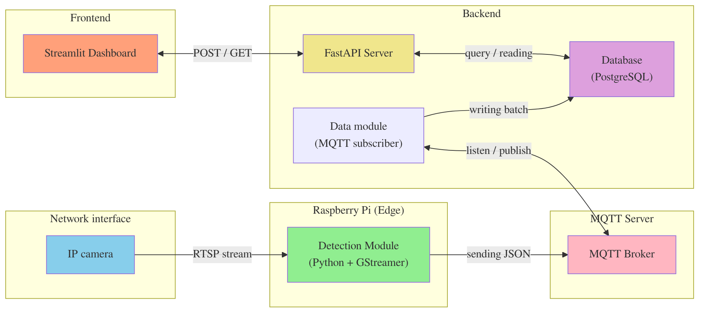

[](https://www.python.org/downloads/)
[-green)](https://hailo.ai/)
[](https://docs.ultralytics.com/)
[](https://mqtt.org/)
[](https://www.postgresql.org/)
[](https://www.docker.com/)
[](https://opensource.org/licenses/MIT)

# Traffic Monitoring and Analysis System using Computer Vision
**Automated real-time traffic monitoring and analysis using Edge AI (Raspberry Pi 5 + Hailo-8) and Computer Vision.**

This repository contains the source code, container configurations, telemetry results, and LaTeX text for my Bachelor's thesis (*Systém pro monitorování a analýzu dopravy pomocí počítačového vidění*). The system processes live RTSP video streams directly at the network edge in compliance with GDPR (*Privacy by Design*) and transmits anonymized vehicle metadata via MQTT to a PostgreSQL database, FastAPI backend, and Streamlit dashboard.


### Key Features
- **Real-time Edge AI Inference (29.39 FPS):** Runs an INT8 quantized **YOLOv8m** (`HEF`) model on a **Raspberry Pi 5** equipped with a **Hailo-8 AI accelerator (26 TOPS)** inside a native C/C++ **GStreamer** pipeline (`hailonet`, `hailotracker`).
- **Reference GPU Pipeline (25.64 FPS):** Full-precision (FP32/FP16) **YOLOv8m** + **ByteTrack** implementation in Python (PyAV, Ultralytics, OpenCV) evaluated on an NVIDIA GeForce RTX 2050 GPU.
- **Unified Polygon ROI Filtering:** Uses `Shapely` polygon geometry on both platforms to count vehicles accurately in the target traffic lane and suppress off-road false positives.
- **Asynchronous Data Pipeline:** Non-blocking **MQTT** publishing (`paho-mqtt`) and connection-pooled batch insertion (`psycopg2`) into **PostgreSQL**.
- **Interactive Analytics Dashboard:** Built with **FastAPI**, **Streamlit**, and **Plotly** for real-time time-series aggregation, class distribution, and heatmaps.
- **Containerized & Reproducible:** Ready-to-run **Docker Compose** setups (both for PC/GPU evaluation and full Edge/RTSP simulation using `/videos/sample_video.mp4`) and **Kubernetes** GPU deployment manifests.

### System Architecture
The system is divided into an Edge processing unit (AI Module), an asynchronous communication and storage layer, and a presentation layer.



### Visuals
**Detection Pipeline:**


**Analytics Dashboard:**


### Repository Structure
- `common/` – Shared Python package (`config.py` for `.env` loading, `DatabaseManagerPostgre.py`, `MQTTClient.py`).
- `rpi_src/` – Edge AI implementation for Raspberry Pi 5 + Hailo-8 (`pipeline/`, `model_compile/`, `db/`, `docker/`).
- `pc_src/` – Reference PC/GPU implementation (`yoloTrafficDetectionSystem_PC_GPU.py`, `traffic_stats.py`, `Dockerfile`, `docker-compose.yml`, `k8s/`).
- `videos/` – Default test video (`sample_video.mp4`) for immediate reproducibility across both platforms and Docker simulations.
- `results/` – Exported telemetry JSON logs (`Hailo_yolov8m_statistics.json`, `GPU_yolov8m_stats.json`) and evaluation plots.
- `tests/` – Unit tests for configuration loading and ROI polygon geometry (`test_common.py`).
- `docs/` – UML class and sequence diagrams (Mermaid) and presentation slides.
- `thesis_text/` – Complete Bachelor's thesis source code in LaTeX (`Bachelor_Thesis_CS.tex`, `chapters/`) and compiled PDF (`Bachelor_thesis.pdf`).

### Quick Start

1. **Clone the repository and configure environment variables:**
```bash
       cp .env.example .env
```
2. **Run unit tests:**
```bash
       python3 -m unittest discover tests
```
3. **Run PC/GPU reference container (reads `/videos/sample_video.mp4`):**
```bash       
       docker compose -f pc_src/docker-compose.yml --profile gpu up --build
```
4. **Run full stack simulation (RTSP camera simulator + DB + FastAPI + Streamlit):**
```bash
       docker compose -f rpi_src/docker/docker-compose.yml --env-file .env up --build
```

### Tech Stack
- **Edge Hardware:** Raspberry Pi
- **Language:** Python
- **Vision:** GStreamer
- **Communication:** MQTT
- **Database:** PostgreSQL
- **BackEnd:** FastApi
- **Visualization:** Streamlit
