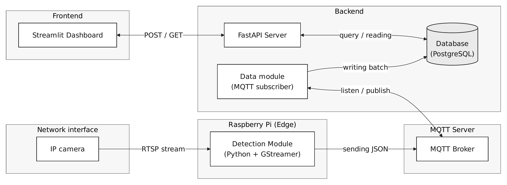
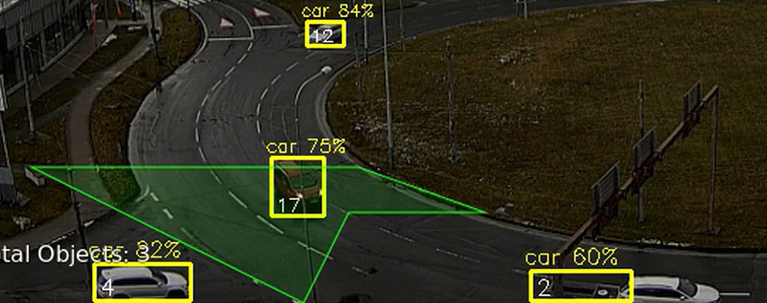
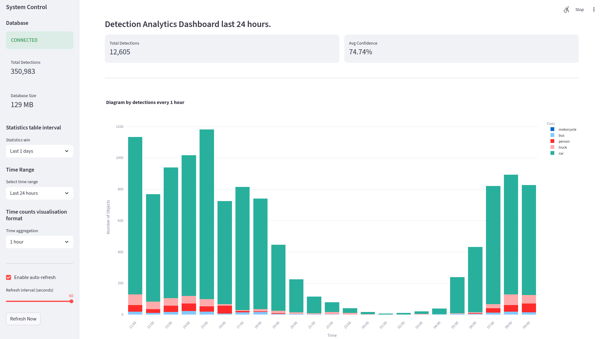

[](https://www.python.org/downloads/)
[-green)](https://hailo.ai/)
[](https://docs.ultralytics.com/)
[](https://mqtt.org/)
[](https://www.postgresql.org/)
[](https://www.docker.com/)
[](https://opensource.org/licenses/MIT)

# Traffic Monitoring and Analysis System using Computer Vision
**Automated real-time traffic monitoring and analysis using Edge AI (Raspberry Pi 5 + Hailo-8) and Computer Vision.**

This repository contains the source code, container configurations, telemetry results, and LaTeX text for my Bachelor's thesis (*Systém pro monitorování a analýzu dopravy pomocí počítačového vidění*). The system processes live RTSP video streams directly at the network edge in compliance with GDPR (*Privacy by Design*) and transmits anonymized vehicle metadata via MQTT to a PostgreSQL database, FastAPI backend, and Streamlit dashboard.


### Key Features
- **Real-time Edge AI Inference (29.39 FPS):** Runs an INT8 quantized **YOLOv8m** (`HEF`) model on a **Raspberry Pi 5** equipped with a **Hailo-8 AI accelerator (26 TOPS)** inside a native C/C++ **GStreamer** pipeline (`hailonet`, `hailofilter`, `hailotracker`) with low CPU load (25–35 %) and ~8–12 W total power draw.
- **Reference GPU Pipeline (25.64 FPS):** Full-precision (FP32/FP16) **YOLOv8m** + **ByteTrack** (`track_buffer = 50`) implementation in Python (PyAV, Ultralytics, OpenCV) evaluated on an NVIDIA GeForce RTX 2050 GPU.
- **Verified Winter Evaluation ($\text{GT} = 112$ vehicles):** Benchmarked in heavy snowfall conditions — Edge AI (Hailo-8) achieved **92.05 % F1-score** (**98.21 % Recall**), while the reference GPU pipeline achieved **95.96 % F1-score** and **99.11 % counting accuracy**.
- **Unified Polygon ROI Filtering:** Uses `Shapely` pentagonal polygon geometry on both platforms to count vehicles accurately in the target traffic lane and suppress off-road false positives.
- **Asynchronous Data Pipeline:** Non-blocking **MQTT** publishing (`paho-mqtt`) and connection-pooled batch insertion (`psycopg2` `ThreadedConnectionPool` + `execute_batch`) into **PostgreSQL**.
- **Interactive Analytics Dashboard:** Built with **FastAPI**, **Streamlit**, and **Plotly** for time-series aggregation, vehicle class distribution, and spatial heatmaps.
- **Containerized & Reproducible:** Ready-to-run **Docker Compose** setups (for PC GPU/CPU evaluation and full Edge/RTSP simulation using `videos/sample_video.mp4`), **Kubernetes** GPU deployment manifests, and **GitHub Actions** CI/CD.

### System Architecture
The system is divided into an Edge processing unit (AI Module), an asynchronous communication and storage layer, and a presentation layer.



### Detection pipeline (RTSP Input)




### Analytics Dashboard



### Repository Structure
- `.github/workflows/` – Automated CI/CD pipeline (`ci.yml`) running unit tests and validating Docker Compose configurations.
- `common/` – Shared Python package (`config.py` for `.env` loading, `DatabaseManagerPostgre.py`, `MQTTClient.py`).
- `rpi_src/` – Edge AI implementation for Raspberry Pi 5 + Hailo-8 (`pipeline/`, `model_compile/`, `db/`, `docker/`, `autosetup_hailo_rpi5.sh`, `autorun.sh`).
- `pc_src/` – Reference PC/GPU implementation (`yoloTrafficDetectionSystem_PC_GPU.py`, `traffic_stats.py`, `bytetrack.yaml`, `Dockerfile`, `docker-compose.yml`, `k8s/`).
- `videos/` – Default test video (`sample_video.mp4`, tracked via Git LFS) for immediate reproducibility across both platforms and Docker simulations.
- `results/` – Exported telemetry JSON logs (`analyzed_outputx264-...__Hailo_yolov8m_statistics.json`, `recording_..._GPU_yolov8m_stats.json`) and evaluation frame scripts.
- `tests/` – Unit tests for configuration loading and ROI polygon geometry (`test_common.py`).
- `docs/` – Architecture diagrams, database ERD, UML class/sequence definitions (`diagrams/`), and presentation slides.
- `thesis_text/` – Complete Bachelor's thesis source code in LaTeX (`Bachelor_Thesis_CS.tex`, `chapters/cs/`) and compiled PDF (`Bachelor_Thesis.pdf`).

### Quick Start

1. **Clone the repository (with Git LFS) and configure environment variables:**
```bash
git lfs install
git clone [https://github.com/imang212/Bachelor_Thesis.git](https://github.com/imang212/Bachelor_Thesis.git)
cd Bachelor_Thesis
cp .env.example .env
```
2. **Run unit tests:**
```bash
python3 -m unittest discover tests
```
3. **Run PC reference container (reads `videos/sample_video.mp4`):**
```bash
# With NVIDIA GPU (requires NVIDIA Container Toolkit)
docker compose -f pc_src/docker-compose.yml --env-file .env --profile gpu up --build

# Or in CPU-only mode
docker compose -f pc_src/docker-compose.yml --env-file .env --profile cpu up --build
```

4. **Run full-stack Edge simulation (RTSP camera simulator + PostgreSQL + FastAPI + Streamlit):**
```bash
docker compose -f rpi_src/docker/docker-compose.yml --env-file .env up --build
```

### Tech Stack
- **Edge Hardware:** Raspberry Pi 5 + Hailo-8 AI Accelerator (26 TOPS)
- **Language:** Python 3.11+
- **Computer Vision & Inference:** YOLOv8m, GStreamer, HailoRT / TAPPAS, Ultralytics, OpenCV, ByteTrack, Shapely
- **Communication:** MQTT (`paho-mqtt`)
- **Database:** PostgreSQL 15+ (`psycopg2`)
- **Backend & API:** FastAPI, Uvicorn
- **Visualization:** Streamlit, Plotly, Pandas
- **DevOps & Deployment:** Docker, Docker Compose, Kubernetes, GitHub Actions

