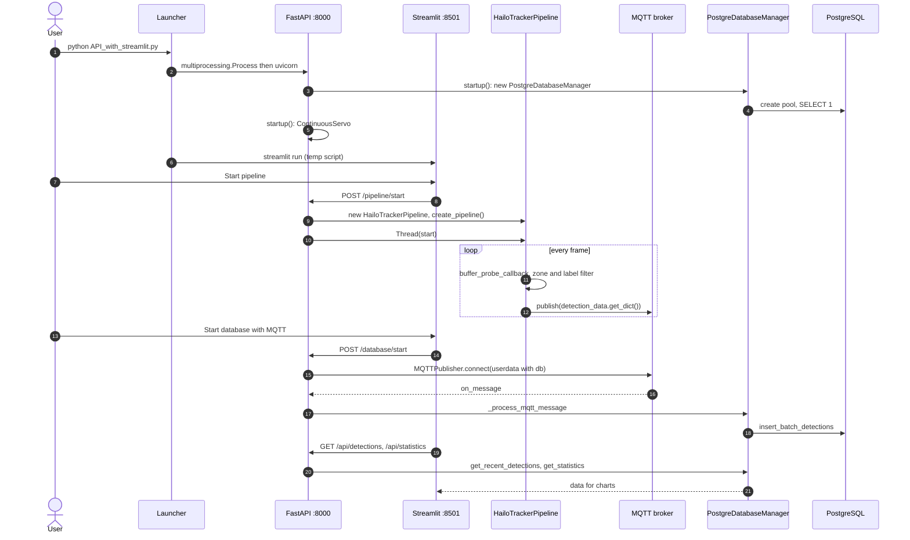

# Traffic Detection System – UML

## Class diagram

```mermaid
classDiagram
direction TB

class Launcher {
    <<API_with_streamlit.py main>>
    +run_fastapi() Popen
    +run_streamlit_process()
    +main()
}

class FastAPIApp {
    <<module: API_with_streamlit.py>>
    -db : PostgreDatabaseManager
    -pipeline : HailoTrackerPipeline
    -pipeline_thread : Thread
    -mqtt_client : MQTTPublisher
    -servo_L : ContinuousServo
    -DB_CONFIG : dict
    -MQTT_CONFIG : dict
    +startup()
    +shutdown()
    +pipeline_start(PipelineConfig)
    +pipeline_stop()
    +pipeline_status() PipelineStatus
    +database_start(DatabaseConfig)
    +database_stop()
    +get_detections() DetectionResponse
    +get_detection_counts()
    +get_statistics() StatisticsResponse
    +move_servo(ServoRequest)
    +camera_snapshots()
}

class StreamlitDashboard {
    <<module: run_streamlit>>
    +fetch_detections()
    +fetch_statistics()
    +fetch_pipeline_status()
    +start_pipeline(config)
    +stop_pipeline()
    +start_database(mqtt)
    +stop_database()
    +compute_timeline(df)
}

class PipelineConfig {
    <<pydantic>>
    +rpicamera : bool
    +video_file : str
    +enable_rtsp : bool
    +enable_websocket : bool
    +enable_mqtt : bool
    +enable_recording : bool
    +output_path : str
    +enable_debug : bool
}
class DatabaseConfig {
    <<pydantic>>
    +mqtt_sending : bool
}
class ServoRequest {
    <<pydantic>>
    +angle : int
    +speed : int
}

class HailoTrackerPipeline {
    -pipeline : Gst.Pipeline
    -loop : GLib.MainLoop
    -rpicamera : bool
    -rtsp_link : str
    -video_file : str
    -model_name : str
    -zone_polygon : Polygon
    -sent_track_ids : set
    -VALID_LABELS : frozenset
    -frame_count : int
    -running : bool
    +create_pipeline()
    +start()
    +stop()
    +buffer_probe_callback(pad, info)
    +on_draw_polygon(overlay, ctx, ts, dur)
    +on_message(bus, message)
    +on_new_sample_rtsp(appsink)
    -_mark_sent(track_id)
}

class DetectionData {
    -detections : list
    -frame_count : int
    -object_counts : dict
    -counted_track_ids : set
    -lock : Lock
    +update(detections, frame_count)
    +get_dict() dict
    +get_json() str
    +get_count_overlay_text() str
}

class VideoStatistics {
    -detections_per_class : dict
    -unique_track_ids : set
    -total_frames : int
    -start_time : datetime
    -end_time : datetime
    +add_detection(class_name, conf, track_id)
    +add_frame(has_detections)
    +get_summary() dict
    +print_summary() dict
}

class RTSPServer {
    -port : int
    -mount_point : str
    -appsrc : Gst.Element
    -appsrc_lock : Lock
    +create_server()
    +start()
    +push_buffer(buffer)
    +on_media_configure(factory, media)
}

class WebSocketServerWithDetectionData {
    <<WebSocket.py - not provided>>
    -host : str
    -port : int
    +run()
    +stop()
}

class MQTTPublisher {
    -broker_host : str
    -broker_port : int
    -topic : str
    -client : mqtt.Client
    -connected : bool
    -lock : Lock
    +connect(userdata)
    +disconnect()
    +publish(data_dict)
    +publish_bulk(detections, delay, batch_size)
    +on_connect(...)
    +on_message(client, userdata, msg)
    +on_disconnect(...)
}

class PostgreDatabaseManager {
    -db_config : dict
    -pool : ThreadedConnectionPool
    -message_buffer : deque
    -inserted_track_ids : set
    -buffer_lock : Lock
    +verify_pool() bool
    +get_connection()
    +return_connection(conn)
    +insert_batch_detections(list)
    +get_recent_detections(minutes, limit)
    +get_counts_detections(minutes, per)
    +get_statistics(hours)
    +get_health_status()
    +close()
    -_process_mqtt_message(msg)
    -_default_message_parser(topic, payload)
}

class ContinuousServo {
    <<ServoControl.py - not provided>>
    +rotate_degrees(angle, speed)
    +cleanup()
}

class MQTTBroker {
    <<external>>
    mqtt.portabo.cz:8883 TLS
    topic /videoanalyza
}
class PostgreSQL {
    <<external>>
    db hailo_db
    table detections
}
class GStreamerHailo {
    <<external>>
    libcamerasrc / rtspsrc / filesrc
    hailonet, hailofilter, hailotracker
}

Launcher ..> FastAPIApp : spawns uvicorn :8000
Launcher ..> StreamlitDashboard : spawns streamlit :8501
StreamlitDashboard ..> FastAPIApp : HTTP REST
FastAPIApp ..> PipelineConfig : request body
FastAPIApp ..> DatabaseConfig : request body
FastAPIApp ..> ServoRequest : request body

FastAPIApp --> HailoTrackerPipeline : creates, runs in thread
FastAPIApp --> PostgreDatabaseManager : owns
FastAPIApp --> MQTTPublisher : owns (DB listener)
FastAPIApp --> ContinuousServo : owns

HailoTrackerPipeline *-- DetectionData
HailoTrackerPipeline *-- "0..1" VideoStatistics : video mode
HailoTrackerPipeline *-- "0..1" RTSPServer : enable_rtsp
HailoTrackerPipeline *-- "0..1" WebSocketServerWithDetectionData : enable_websocket
HailoTrackerPipeline *-- "0..1" MQTTPublisher : enable_mqtt
WebSocketServerWithDetectionData o-- DetectionData : shared ref
HailoTrackerPipeline ..> GStreamerHailo : parse_launch

MQTTPublisher ..> MQTTBroker : publish / subscribe
MQTTPublisher ..> PostgreDatabaseManager : on_message via userdata
PostgreDatabaseManager ..> PostgreSQL : psycopg2 pool
```

## Launch / runtime flow



## Standalone launch modes

| Command | What runs |
| --- | --- |
| `python DetectionWithGStreamer_pipeline.py [--enable-mqtt --enable-rtsp ...]` | `main()` builds `HailoTrackerPipeline`, runs the GLib main loop in the foreground |
| `python DatabaseManagerPostgre.py` | `main()` creates `PostgreDatabaseManager` + `MQTTPublisher` listener, prints health every 30 s |
| `python MQTTClient.py` | Test subscriber on `/videoanalyza` |
| `python API_with_streamlit.py` | Launcher: FastAPI (8000) + Streamlit (8501) |