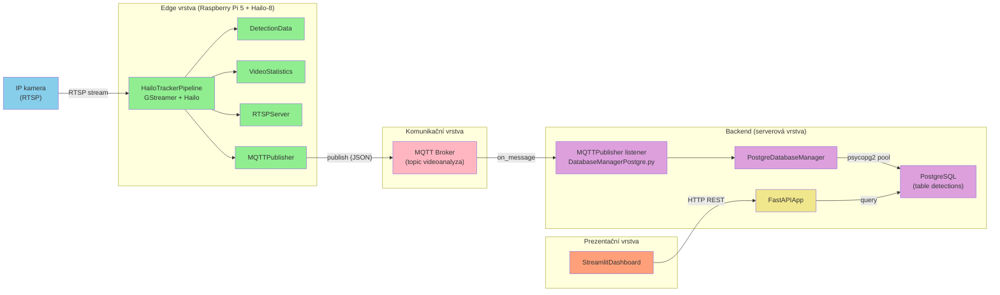
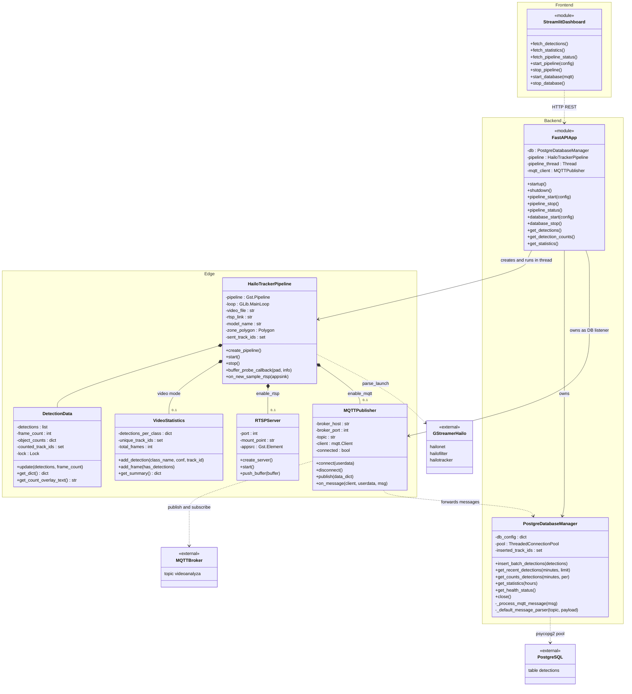
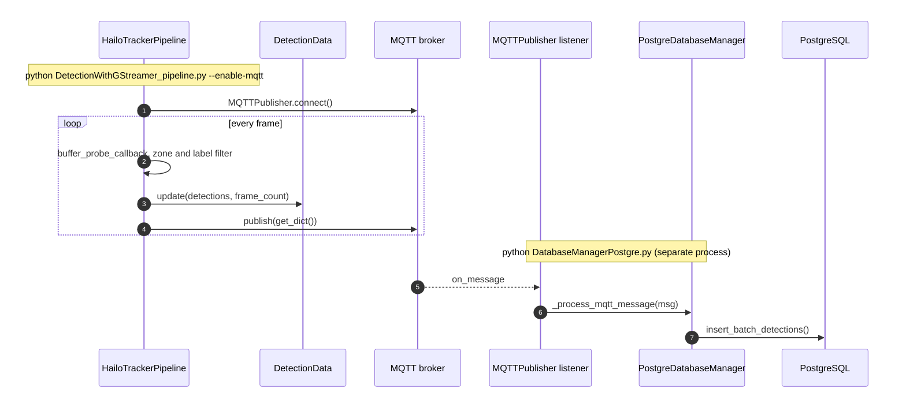
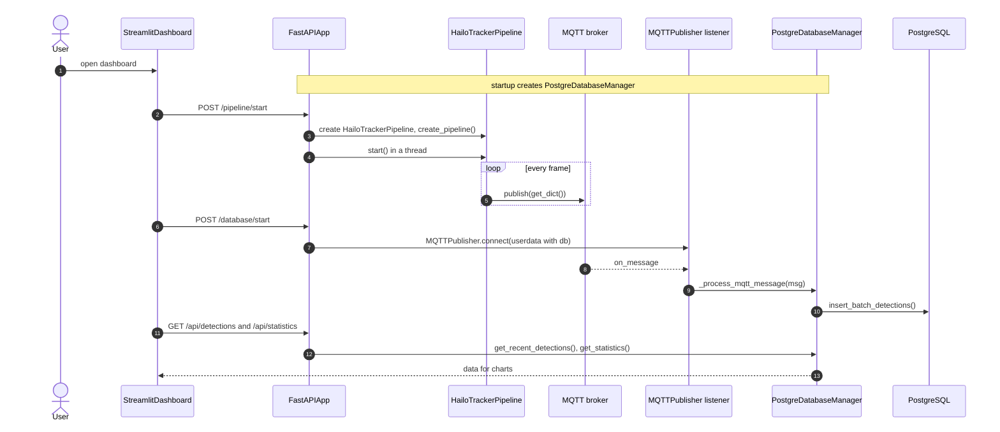

# Traffic Detection System – UML (slovně / vrstevně uspořádaná verze)

> Tento soubor obsahuje **stejný obsah** jako `system_uml_2.md`, ale rozdělený
> podle architektoních vrstev, aby byl přehlednější:
>
> - **Prehledová schéma** (flowchart) – data tok přes edge → komunikační → backend → frontend.
> - **Třídový diagram** – třídy sklopené do `namespace` (edge, backend, frontend).
>   *Pozn.: Mermaid `namespace` uvnitř `classDiagram` vyžaduje Mermaid ≥ 10.6.*
> - **Sekvenční diagramy** – s `box` seskupením aktérů podle vrstev.
>
> Barvy odpovídají `diagram_converter.py` (architecture.png):
> zelená = edge, modrá = kamera, růžová = MQTT, fialová = DB, béžová = FastAPI, lososová = Streamlit.

## Prehledová schéma (flowchart)

## Třídový diagram (založený do vrstev)

## Sekvenční diagram – zakladní tok (bez API)

## Sekvenční diagram – rozširená verze (s FastAPI a Streamlit)

