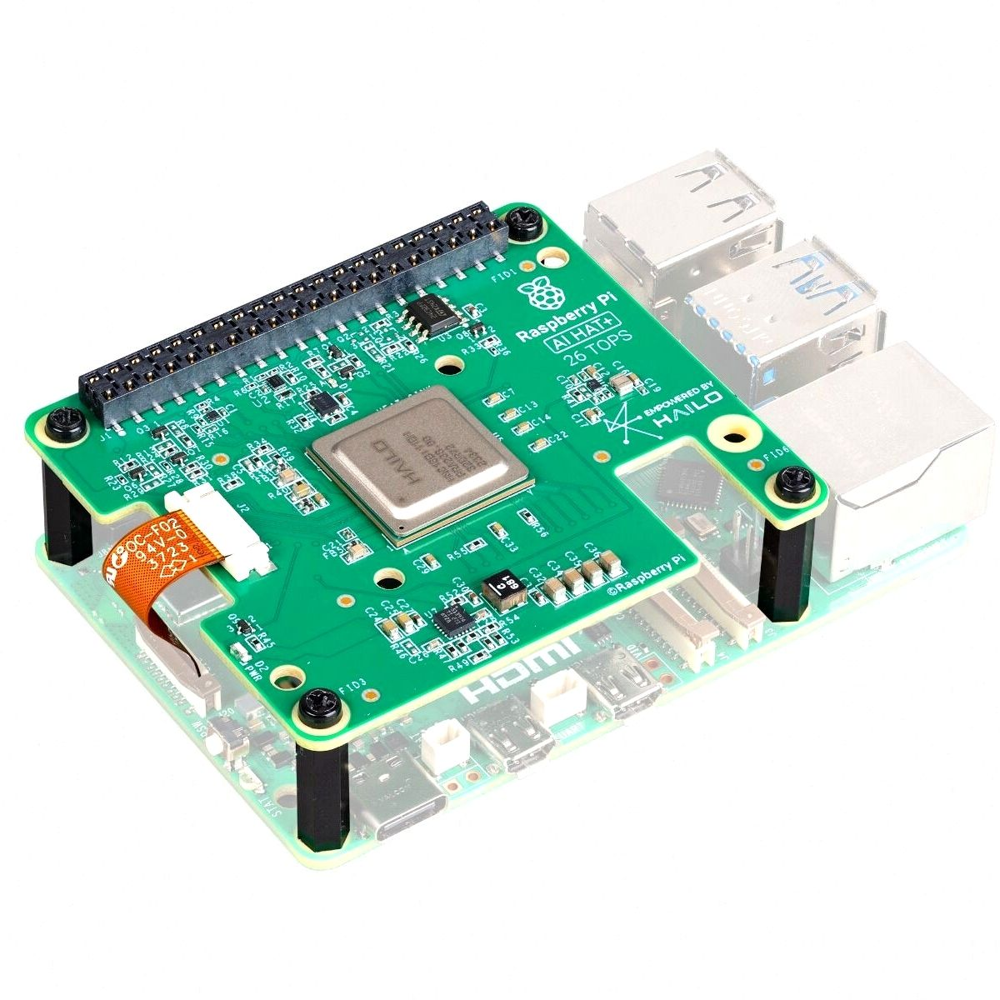

# Hailo-8 & GStreamer Detection Pipeline Guide

Practical guide for installing drivers, configuring the runtime environment, and running the real-time traffic detection pipeline on **Raspberry Pi 5** with the **Hailo-8 (26 TOPS)** AI accelerator.
## 1. Hardware Setup (Raspberry Pi 5 + Hailo-8 AI HAT+)

The edge unit consists of a Raspberry Pi 5 connected via PCIe Gen 3.0 to the Hailo-8 AI accelerator and an IMX708 camera module (or an external IP camera streaming over RTSP).



## 2. Direct Links to Repository Scripts & Hailo Resources

### Scripts in This Repository (`imang212/Bachelor_Thesis`)
- **Automated multi-stage setup & repair script (Bash):** [`rpi_src/autosetup_hailo_rpi5.sh`](https://github.com/imang212/Bachelor_Thesis/blob/main/rpi_src/autosetup_hailo_rpi5.sh)
- **Automated service startup on boot (systemd):** [`rpi_src/autorun.sh`](https://github.com/imang212/Bachelor_Thesis/blob/main/rpi_src/autorun.sh)
- **Main GStreamer + Hailo-8 detection pipeline:** [`rpi_src/pipeline/DetectionWithGStreamer_pipeline.py`](https://github.com/imang212/Bachelor_Thesis/blob/main/rpi_src/pipeline/DetectionWithGStreamer_pipeline.py)
- **FastAPI backend & service launcher:** [`rpi_src/pipeline/API_with_streamlit.py`](https://github.com/imang212/Bachelor_Thesis/blob/main/rpi_src/pipeline/API_with_streamlit.py)
- **Interactive analytics dashboard (Streamlit + Plotly):** [`rpi_src/pipeline/streamlit_dashboard.py`](https://github.com/imang212/Bachelor_Thesis/blob/main/rpi_src/pipeline/streamlit_dashboard.py)
- **Model compilation to HEF format (Jupyter Notebook):** [`rpi_src/model_compile/model_compilation.ipynb`](https://github.com/imang212/Bachelor_Thesis/blob/main/rpi_src/model_compile/model_compilation.ipynb)
- **Full-stack Docker simulation:** [`rpi_src/docker/docker-compose.yml`](https://github.com/imang212/Bachelor_Thesis/blob/main/rpi_src/docker/docker-compose.yml)

### Official Hailo GitHub Repositories & Developer Zone Downloads
Official open-source repositories on GitHub:
- **Hailo RPi5 Examples:** [https://github.com/hailo-ai/hailo-rpi5-examples](https://github.com/hailo-ai/hailo-rpi5-examples) (branch `25.7.0`)
- **Hailo TAPPAS:** [https://github.com/hailo-ai/tappas](https://github.com/hailo-ai/tappas) (branch `v5.2.0`)
- **HailoRT (source code):** [https://github.com/hailo-ai/hailort](https://github.com/hailo-ai/hailort) (branch `v5.2.0`)
- **Hailo Model Zoo:** [https://github.com/hailo-ai/hailo_model_zoo](https://github.com/hailo-ai/hailo_model_zoo) (branch `v5.2.0`)

> **Downloading Official Hailo Binary Packages (`.deb` / `.whl`):**
> Precompiled driver packages (`hailort-pcie-driver`, `hailort`) and the `Hailo Dataflow Compiler (DFC)` wheel packages are available at the **[Hailo Developer Zone – Software Downloads](https://hailo.ai/developer-zone/software-downloads/)**. To download them, register for a free developer account on the Hailo website, sign in, and select the target architecture (`arm64` for Raspberry Pi 5 runtime, `x86_64` for model compilation on PC).

## 3. Instalace systémových závislostí a ovladačů
Celou instalaci lze provést buď **plně automaticky** spuštěním skriptu [`rpi_src/autosetup_hailo_rpi5.sh`](https://github.com/imang212/Bachelor_Thesis/blob/main/rpi_src/autosetup_hailo_rpi5.sh), nebo **manuálně** podle kroků níže.

## 3. System Dependencies & Driver Installation

You can run the entire installation **automatically** using [`rpi_src/autosetup_hailo_rpi5.sh`](https://github.com/imang212/Bachelor_Thesis/blob/main/rpi_src/autosetup_hailo_rpi5.sh) (which handles reboots via a temporary `systemd` service), or perform the steps **manually** as shown below.

### 3.1 Install System Packages & GStreamer Plugins

```bash
sudo apt-get update && sudo apt-get install -y \
    python3 python3-venv python3-pip python3-dev python3-setuptools python3-virtualenv \
    build-essential cmake git wget curl pkg-config rsync \
    gcc-12 g++-12 gfortran \
    libopenblas-dev libatlas-base-dev libopencv-dev python3-opencv \
    libjpeg-dev libpng-dev libavcodec-dev libavformat-dev libavutil-dev \
    libswscale-dev libswresample-dev libavdevice-dev \
    libv4l-dev libxvidcore-dev libx264-dev libhdf5-dev libhdf5-serial-dev \
    libcap-dev libarchive-dev libfreetype6 libcairo2-dev libzmq3-dev \
    libcamera0 rpicam-apps ffmpeg x11-utils \
    python3-gi python3-gi-cairo python-gi-dev libgirepository1.0-dev \
    libgstreamer1.0-dev libgstreamer-plugins-base1.0-dev libgstreamer-plugins-bad1.0-dev \
    gstreamer1.0-tools gstreamer1.0-plugins-base gstreamer1.0-plugins-good \
    gstreamer1.0-plugins-bad gstreamer1.0-plugins-ugly gstreamer1.0-libav \
    gstreamer1.0-x gstreamer1.0-alsa gstreamer1.0-gl gstreamer1.0-gtk3 \
    gstreamer1.0-pulseaudio gir1.2-gtk-3.0 \
    gir1.2-gst-rtsp-server-1.0 gir1.2-gstreamer-1.0 \
    python3-paho-mqtt python3-websockets
```

### 3.2 Install PCIe Driver & HailoRT Runtime

Download the `.deb` packages from the [Hailo Developer Zone](https://hailo.ai/developer-zone/software-downloads/) (or use the Raspberry Pi OS distribution packages `sudo apt install hailo-all` with pinned versions `hailort=4.20.0-1 python3-hailort=4.20.0-1 hailo-tappas-core=3.31.0+1-1`):

```bash
# Install downloaded HailoRT 4.23.0 packages (arm64)
sudo dpkg -i hailort_4.23.0_arm64.deb hailort-pcie-driver_4.23.0_all.deb
sudo apt-get install -f -y
sudo reboot

# Verify kernel module and device firmware after reboot
lsmod | grep hailo
hailortcli fw-control identify
```

### 3.3 Install TAPPAS & Configure GStreamer Bindings
```bash
git clone --branch v5.2.0 --depth 1 https://github.com/hailo-ai/tappas.git ~/tappas
cd ~/tappas
mkdir -p hailort
git clone --branch v5.2.0 --depth 1 https://github.com/hailo-ai/hailort.git hailort/sources

# Clear old GStreamer registry cache
rm -rf ~/.cache/gstreamer-1.0/
sudo rm -rf /root/.cache/gstreamer-1.0/
sudo rm -f /usr/lib/$(uname -m)-linux-gnu/gstreamer-1.0/libgsthailotools.so

# Install TAPPAS
./install.sh --skip-hailort

# Fix symlink for libgsthailometa.so GStreamer plugin
sudo ln -sf /usr/lib/aarch64-linux-gnu/libgsthailometa.so.5.2.0 /usr/lib/aarch64-linux-gnu/libgsthailometa.so.3

# Verify Hailo GStreamer elements
gst-inspect-1.0 | grep hailo
```

### 3.4 Clone `hailo-rpi5-examples` & `hailo_model_zoo`

```bash
cd ~
git clone --branch 25.7.0 --depth 1 https://github.com/hailo-ai/hailo-rpi5-examples.git
git clone --branch v5.2.0 --depth 1 https://github.com/hailo-ai/hailo_model_zoo.git
cd ~/hailo-rpi5-examples
./install.sh
```

## 4. Running the Detection Pipeline (`DetectionWithGStreamer_pipeline.py`)

Run all commands from the repository root (`Bachelor_Thesis/`), where the `.env` configuration file is located:

```bash
# 1. Analyze a video file offline and generate JSON statistics
python3 -m rpi_src.pipeline.DetectionWithGStreamer_pipeline --video-file videos/sample_video.mp4

# 2. Analyze a video file, record annotated MP4 output, and publish detections to MQTT
python3 -m rpi_src.pipeline.DetectionWithGStreamer_pipeline \
    --video-file videos/sample_video.mp4 \
    --enable-recording \
    --output-path analyzed_output.mp4 \
    --enable-mqtt

# 3. Live RTSP stream from IP camera (configured via CAMERA_RTSP_URL in .env) with MQTT publishing
python3 -m rpi_src.pipeline.DetectionWithGStreamer_pipeline --enable-mqtt

# 4. Live IP camera with RTSP output re-streaming, video recording, and MQTT publishing
python3 -m rpi_src.pipeline.DetectionWithGStreamer_pipeline \
    --enable-rtsp \
    --enable-recording \
    --output-path live_recording.mp4 \
    --enable-mqtt
```

## 5. GStreamer Diagnostic CLI Commands (`gst-launch-1.0`)
### Test Raspberry Pi Camera (IMX708) with Hailo-8 Inference (`fakesink`)
```bash
gst-launch-1.0 \
  libcamerasrc ! \
  video/x-raw,format=NV12,width=1536,height=864,framerate=30/1 ! \
  videoconvert ! videoscale ! \
  video/x-raw,format=RGB,width=640,height=640 ! \
  hailonet hef-path=/home/imang/hailo-rpi5-examples/resources/models/hailo8/yolov8m.hef name=hailonet ! \
  hailofilter function-name=yolov8m \
    so-path=/usr/lib/aarch64-linux-gnu/hailo/tappas/post_processes/libyolo_hailortpp_post.so \
    qos=false name=hailofilter ! \
  hailotracker kalman-dist-thr=0.95 iou-thr=0.5 keep-tracked-frames=45 keep-new-frames=5 keep-lost-frames=50 name=hailotracker ! \
  hailooverlay show-confidence=true line-thickness=2 name=hailooverlay ! \
  videoconvert ! fakesink
```

### Test RTSP Camera Stream with Live Window Output (`autovideosink`)

```bash
gst-launch-1.0 \
  rtspsrc location="rtsp://<username>:<password>@<IP_address>/Stream" latency=150 ! \
  rtph264depay ! h264parse ! avdec_h264 ! \
  videoconvert ! videoscale ! \
  video/x-raw,format=RGB,width=640,height=640 ! \
  hailonet hef-path=/home/imang/hailo-rpi5-examples/resources/models/hailo8/yolov8m.hef batch-size=1 ! \
  queue leaky=downstream max-size-buffers=5 max-size-bytes=0 max-size-time=0 ! \
  hailofilter function-name=yolov8m \
    so-path=/usr/lib/aarch64-linux-gnu/hailo/tappas/post_processes/libyolo_hailortpp_post.so \
    qos=false ! \
  queue leaky=no max-size-buffers=5 max-size-bytes=0 max-size-time=0 ! \
  hailotracker kalman-dist-thr=0.95 iou-thr=0.5 keep-tracked-frames=45 keep-new-frames=5 keep-lost-frames=50 ! \
  hailooverlay show-confidence=true line-thickness=2 ! \
  textoverlay text='Hailo Tracker - YOLOv8m' valignment=top halignment=left font-desc='Sans 12' ! \
  videoconvert ! autovideosink
```

### View Re-streamed RTSP Output from Raspberry Pi

```bash
gst-launch-1.0 -v rtspsrc location=rtsp://<rpi_ip_address>:8554/hailo_stream latency=0 ! \
  rtph264depay ! h264parse ! avdec_h264 ! videoconvert ! autovideosink
```


#### rpi5-examples repository install and Detection test 
```bash
git clone https://github.com/hailo-ai/hailo-rpi5-examples.git
cd hailo-rpi5-examples
./install.sh
source setup_env.sh
python basic_pipelines/detection_simple.py
```

### Commands (DetectionWithGStreamer_pipeline.py script)
```bash
# Analyze video file with only statistics
python3 DetectionWithGStreamer_pipeline.py --video input.mp4

# Analyze and record output
python3 DetectionWithGStreamer_pipeline.py --video input.mp4 --enable-recording --output analyzed.mp4

python3 AI_traffic_detection_hailo/DetectionWithGStreamer_pipeline.py --video outputx264-202601091302.mp4 --enable-recording --output analyzed.mp4 --enable-mqtt 
python3 AI_traffic_detection_hailo/DetectionWithGStreamer_pipeline.py --video outputc264-202601121303.mp4 --enable-recording --output analyzed_outputc264-202601121303.mp4

# Live IP camera with recording
python3 DetectionWithGStreamer_pipeline.py --enable-recording --output live_recording.mp4

python3 DetectionWithGStreamer_pipeline.py --enable-recording --output live_recording.mp4 --enable-mqtt

### Full features enabled
python3 DetectionWithGStreamer_pipeline.py --video test.mp4 --enable-recording --enable-mqtt

# From IP Camera with rtsp pipeline detection streaming and mqtt sending 
python3 AI_traffic_detection_hailo/DetectionWithGStreamer_pipeline.py --enable-rtsp --enable-mqtt


```

```bash

GStreamer console testing commands:
gst-launch-1.0 \
  libcamerasrc ! \
  video/x-raw,format=NV12,width=1536,height=864,framerate=30/1 ! \
  videoconvert ! \
  videoscale ! \
  video/x-raw,format=RGB, width=640,height=640 ! \
  hailonet hef-path=/home/imang/hailo-rpi5-examples/resources/models/hailo8/yolov8m.hef name=hailonet ! \
  hailofilter function-name=yolov8 \
    config-path=/home/imang/hailo_model_zoo/hailo_model_zoo/cfg/postprocess_config/yolov8m_nms_config.json \
    name=hailofilter ! \
  hailotracker kalman-dist-thr=0.7 iou-thr=0.3 keep-tracked-frames=30 keep-new-frames=3 keep-lost-frames=10 name=hailotracker ! \
  hailooverlay show-confidence=true line-thickness=2 name=hailooverlay ! \
  textoverlay text='Hailo Tracker - YOLOv8m' valignment=top halignment=left font-desc='Sans 12' ! \
  videoconvert ! \
  video/x-raw,format=I420 ! \
  tee name=t \
    t. ! queue ! fakesink

Test with rtsp:
gst-launch-1.0 \
  libcamerasrc ! \
  video/x-raw,format=NV12,width=1536,height=864,framerate=30/1 ! \
  videoconvert ! \
  videoscale ! \
  video/x-raw,format=RGB, width=640, height=640 ! \
  hailonet hef-path=/home/imang/hailo-rpi5-examples/resources/models/hailo8/yolov8m.hef name=hailonet ! \
  hailofilter function-name=yolov8 \
    config-path=/home/imang/hailo_model_zoo/hailo_model_zoo/cfg/postprocess_config/yolov8m_nms_config.json \
    name=hailofilter ! \
  hailotracker kalman-dist-thr=0.7 iou-thr=0.3 keep-tracked-frames=30 keep-new-frames=3 keep-lost-frames=10 
  name=hailotracker ! \
  hailooverlay show-confidence=true line-thickness=2 name=hailooverlay ! \
  textoverlay text='Hailo Tracker - YOLOv8m' valignment=top halignment=left font-desc='Sans 12' ! \
  videoconvert ! \
  video/x-raw,format=I420 ! \
  tee name=t \
     t. ! queue ! videoconvert ! video/x-raw,format=I420,width=1536,height=864 ! appsink name=rtsp_sink emit-signals=true sync=false \
      t. ! queue ! fakesink

Small test:  
  gst-launch-1.0 \
  libcamerasrc ! video/x-raw,format=NV12,width=1536,height=864,framerate=30/1 ! \
  videoconvert ! video/x-raw ! videoscale ! video/x-raw,width=640,height=640 ! \
  hailonet hef-path=/home/imang/hailo-rpi5-examples/resources/models/hailo8/yolov8m.hef name=hailonet ! \
  hailofilter function-name=yolov8 \
    config-path=/home/imang/hailo_model_zoo/hailo_model_zoo/cfg/postprocess_config/yolov8m_nms_config.json \
    so-path=/home/imang/hailo-rpi5-examples/resources/so/libyolov8_postprocess.so \
    name=hailofilter ! \
  fakesink

Test with window:
gst-launch-1.0 \
  rtspsrc location="rtsp://<username>:<password>@<IP_address>/Stream" latency=0 ! rtph264depay ! h264parse ! avdec_h264 ! \
  videoconvert ! \
  videoscale ! \
  video/x-raw,format=RGB,width=640,height=640 ! \
  hailonet hef-path=/home/imang/hailo-rpi5-examples/resources/models/hailo8/yolov8m.hef batch-size=1 ! \
  queue leaky=no max-size-buffers=30 max-size-bytes=0 max-size-time=0 ! \
  hailofilter function-name=yolov8m \
    so-path=/usr/lib/aarch64-linux-gnu/hailo/tappas/post_processes/libyolo_hailortpp_post.so \
    qos=false ! \
  queue leaky=no max-size-buffers=30 max-size-bytes=0 max-size-time=0 ! \
  hailotracker kalman-dist-thr=0.7 iou-thr=0.3 keep-tracked-frames=30 keep-new-frames=3 keep-lost-frames=10 ! \
  hailooverlay show-confidence=true line-thickness=2 ! \
  textoverlay text='Hailo Tracker - YOLOv8m' valignment=top halignment=left font-desc='Sans 12' ! \
  videoconvert ! \
  autovideosink

GStreamer test
gst-launch-1.0 \
    rtspsrc location="rtsp://<username>:<password>@<IP_address>/Stream" latency=0 ! \
    rtph264depay ! h264parse ! avdec_h264 ! videoconvert ! \
    videoscale ! \
    video/x-raw,format=RGB, width=640,height=640 ! \
    hailonet hef-path=/home/imang/hailo-rpi5-examples/resources/models/hailo8/yolov8m.hef name=hailonet ! \
    hailofilter function-name=yolov8 \
        config-path=/home/imang/hailo_model_zoo/hailo_model_zoo/cfg/postprocess_config/yolov8m_nms_config.json \
        name=hailofilter ! \
    hailotracker kalman-dist-thr=0.7 iou-thr=0.3 keep-tracked-frames=30 keep-new-frames=3 keep-lost-frames=10 name=hailotracker ! \
    hailooverlay show-confidence=true line-thickness=2 name=hailooverlay ! \
    textoverlay text='Hailo Tracker - YOLOv8m' valignment=top halignment=left font-desc='Sans 12' ! \
    autovideosink !

Launch RSTP stream from camera:
gst-launch-1.0 -v rtspsrc location=rtsp://<rpi_ip_address>:8554/hailo_stream latency=0 ! rtph264depay ! h264parse ! avdec_h264 ! videoconvert ! autovideosink
Launch real stream from camera:
gst-launch-1.0 rtspsrc location="rtsp://<username>:<password>@<IP_address>/Streaming/Channels" latency=0 !   rtph264depay ! h264parse ! avdec_h264 ! videoconvert ! autovideosink
```
